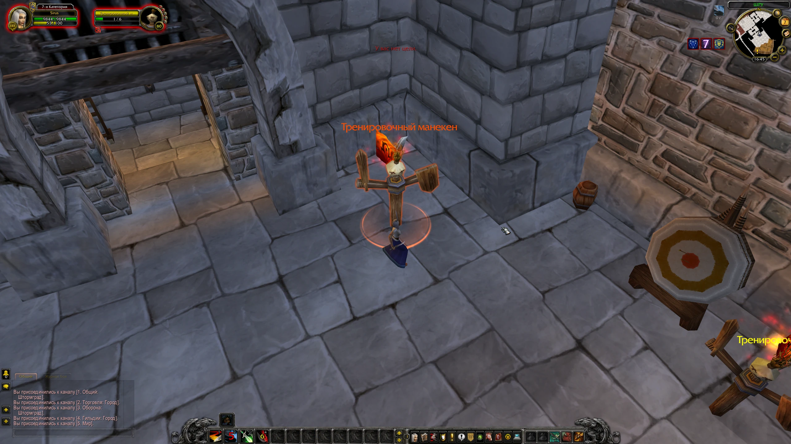
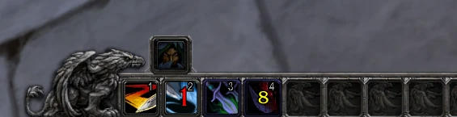
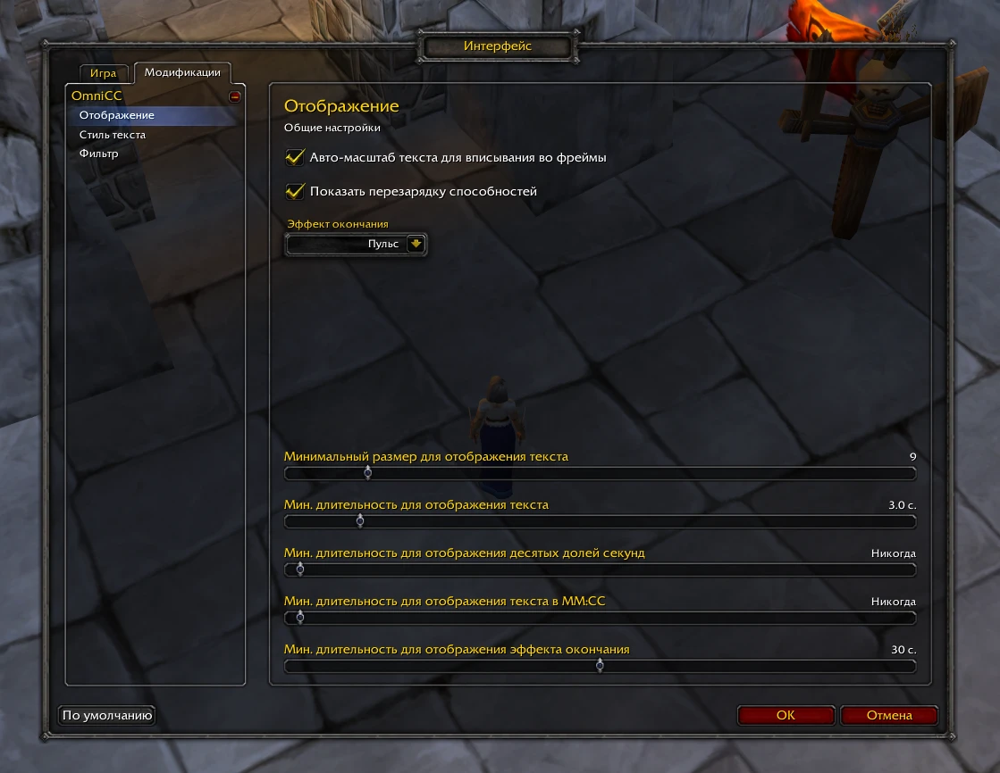
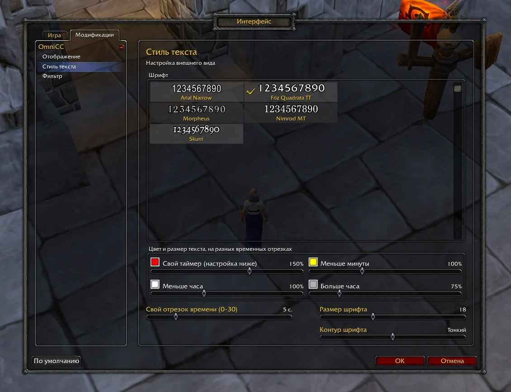
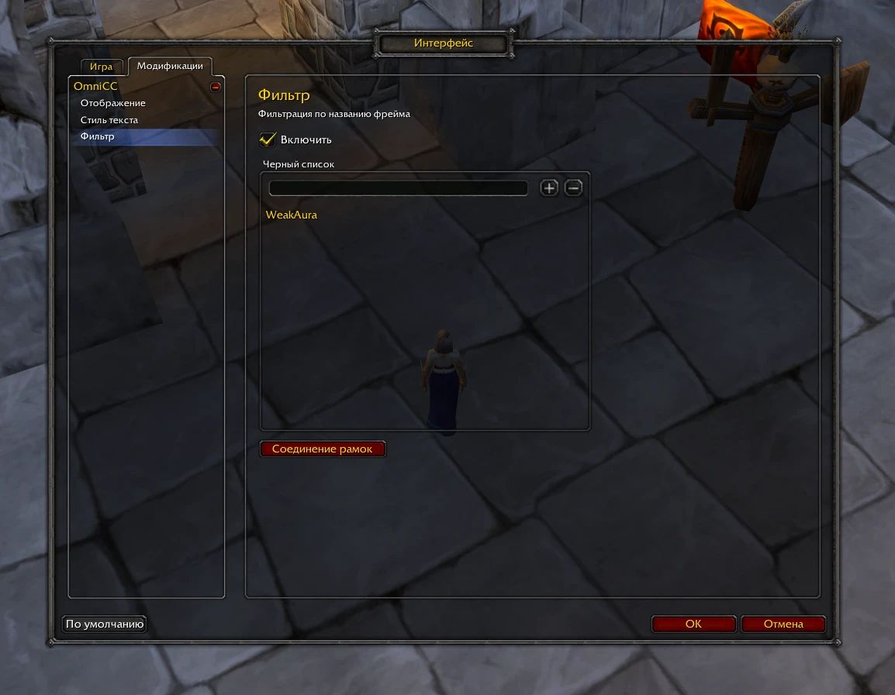

**OmniCC** - модификация, точно показывающий оставшееся время до отката (кд) способности и предметов. В настройках аддона можно изменить вид отображения на свой вкус.

Особенности:
- Гибкие настройки;
- Наглядное отображение отката КД.

Настройка:\
ESC -> Интерфейс -> Модификации -> OmniCC - окно настройки.

**Скриншоты:**

